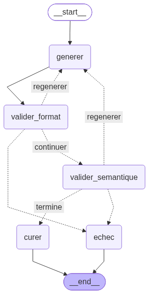

# Génération de jeux de données synthétiques

Pipeline multi-agents qui crée des lignes synthétiques à partir d'un jeu de données source, vérifie leur format et écarte les quasi-doublons avant de sauvegarder les résultats. Le projet utilise Ollama pour générer les données et leurs embeddings, LangGraph pour orchestrer les traitements par batch, MLflow pour suivre les expériences et DVC pour versionner les datasets.

## Fonctionnalités

- Génération guidée par des personas adaptés au dataset.
- Validation du schéma et dédoublonnage sémantique par similarité cosinus.
- Régénération des batches rejetés avec le motif de validation comme consigne.
- Export des résultats en CSV et Parquet, avec métriques de diversité du texte.
- Suivi des paramètres et métriques dans MLflow ; versionnement facultatif des données avec DVC.
- Interface Streamlit pour tester le pipeline standard ou lancer une génération massive.

## Prérequis

- Python 3.13 ou plus récent.
- [Ollama](https://ollama.com/download) installé et démarré.
- Le modèle de génération `qwen2.5:7b-instruct` et le modèle d'embeddings `nomic-embed-text` téléchargés dans Ollama.

Dans un terminal, récupérez les modèles :

```bash
ollama pull qwen2.5:7b-instruct
ollama pull nomic-embed-text
```

Ollama écoute par défaut sur `http://localhost:11434`. Le pipeline actif utilise le modèle local et n'a pas besoin de clé d'API. Pour utiliser un autre hôte ou modèle, définissez les variables suivantes dans l'environnement ou dans un fichier `.env` à la racine :

```dotenv
OLLAMA_HOST=http://localhost:11434
OLLAMA_MODEL=qwen2.5:7b-instruct
OLLAMA_EMBED_MODEL=nomic-embed-text
```

## Installation

Depuis la racine du dépôt, créez un environnement virtuel et installez les dépendances :

```powershell
py -3.13 -m venv .venv
.\.venv\Scripts\Activate.ps1
python -m pip install -r requirements.txt
```

Vous pouvez également utiliser [uv](https://docs.astral.sh/uv/) avec le fichier de verrouillage fourni :

```bash
uv sync
```

## Démarrage rapide

### Interface Streamlit

```bash
streamlit run app.py
```

Dans l'application, chargez un fichier CSV dans la barre latérale, choisissez le pipeline standard pour une génération exploratoire ou l'onglet de génération massive pour un run suivi. Les résultats peuvent être téléchargés en CSV ou Parquet depuis l'interface.

### Pipeline standard en ligne de commande

```bash
python -m src.main
```

Si `data/input/dataset_clients_reel.csv` n'existe pas, ce mode crée un petit jeu de démonstration. Il génère ensuite plusieurs batches et sauvegarde les données validées dans `data/output/donnees_synthetiques_multi_agents.csv` et `.parquet`.

### Génération massive

Le mode massif lit par défaut `data/input/dataset_clients_reel.csv`. Placez-y votre CSV source avant de lancer la commande :

```bash
python -m src.main_massive --cible 5000 --batch 10 --seeds 3 --seuil 0.85 --tentatives 3 --checkpoint 20
```

Options disponibles :

| Option | Défaut | Description |
| --- | ---: | --- |
| `--cible` | `5000` | Nombre de lignes validées visé |
| `--batch` | `10` | Nombre de lignes demandées par génération |
| `--seeds` | `3` | Nombre d'exemples source fournis au modèle par batch |
| `--seuil` | `0.85` | Seuil de similarité cosinus au-dessus duquel une ligne est considérée comme doublon |
| `--tentatives` | `3` | Nombre maximal de tentatives par batch |
| `--checkpoint` | `20` | Fréquence de sauvegarde intermédiaire, en batches |

Le CSV source doit pouvoir être lu par pandas et comporter des lignes. Ses colonnes et types servent de schéma attendu pour les données générées. Le mode massif en ligne de commande utilise le chemin par défaut ci-dessus ; pour sélectionner un autre fichier, appelez `executer_generation_massive(fichier_source=...)` depuis Python.

## Résultats et suivi

Les fichiers de sortie sont écrits dans `data/output/` :

- Le pipeline standard produit `donnees_synthetiques_multi_agents.csv` et `.parquet`.
- Le mode massif produit `dataset_massif.csv` et `.parquet`, ainsi que des checkpoints périodiques nommés `checkpoint_en_cours`.

Les fichiers générés sont ignorés par Git. Les expériences MLflow sont stockées localement dans `mlruns/`. Pour consulter le tableau de bord, lancez depuis la racine du dépôt :

```bash
mlflow ui
```

Puis ouvrez [http://localhost:5000](http://localhost:5000). Les runs enregistrent notamment les paramètres de génération, les métriques par batch et les métriques finales de diversité du texte.

### Versionnement DVC (facultatif)

La configuration DVC du dépôt est déjà présente dans `.dvc/`. Le mode massif en ligne de commande tente automatiquement de versionner le Parquet final. Le dépôt configure un remote local ; vérifiez que son emplacement est disponible avant de pousser les données. Après une génération, ajoutez le fichier pointeur `.dvc` à Git puis poussez le contenu vers le remote :

```bash
git add data/output/dataset_massif.parquet.dvc
git commit -m "Versionner le dataset généré"
dvc push
```

L'interface Streamlit propose également le versionnement DVC à la fin d'un run massif, si cette option est activée.

## Architecture

Le pipeline massif orchestre le cycle génération → validation du format → validation sémantique → curation. Les rejets sont renvoyés au générateur jusqu'à la limite de tentatives configurée.



## Aide et contributions

Pour signaler un problème ou demander de l'aide, ouvrez une [issue](https://github.com/aybnjm2/synthetic-dataset-generation/issues). Les contributions sont les bienvenues : ouvrez une pull request avec un résumé des changements et leur validation. Pour discuter avant de commencer, utilisez une issue.

Le dépôt ne précise pas de mainteneur individuel ; consultez le [profil du propriétaire du dépôt](https://github.com/aybnjm2) et contactez les responsables via les issues ou les pull requests.

## Licence

Aucun fichier de licence n'est actuellement fourni dans le dépôt.
